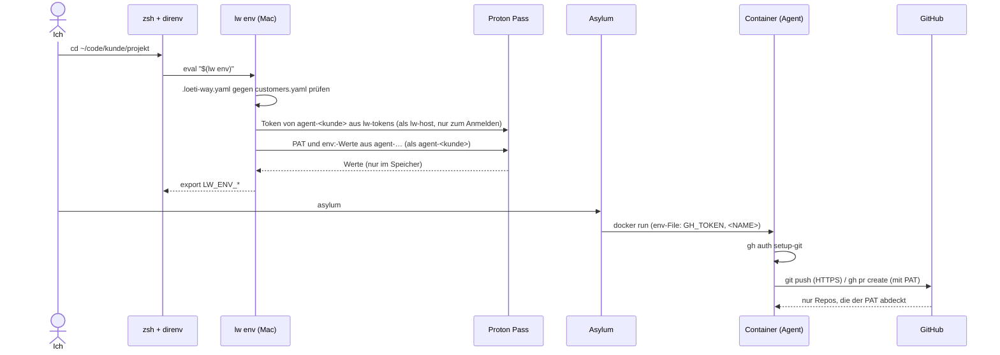
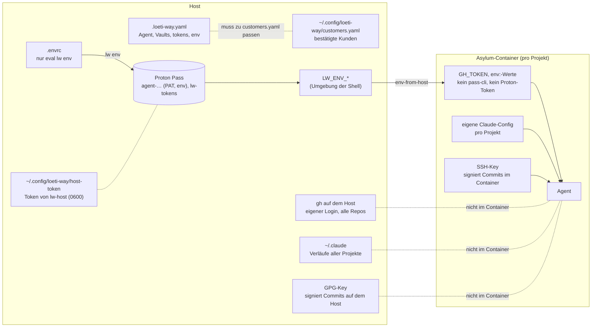

# Coding-Agents in der Sandbox – mit genau den Rechten, die sie brauchen

Coding-Agents wie Claude Code arbeiten am produktivsten, wenn man sie lässt: ohne Rückfrage bei jedem Befehl. Dafür laufen sie bei mir in [Asylum](https://github.com/inventage-ai/asylum), einem Docker-Container pro Projekt. Offen blieb eine Frage: Wie kommt der Agent an GitHub und an die Secrets eines Kunden, ohne dass er meinen persönlichen Zugang mit Zugriff auf alle Repos bekommt?

> **Stand 07.11.2026.** Beschrieben ist das Setup mit dem *Development Build* von Asylum (`main`). Er enthält alle nötigen PRs, ein stabiles Release folgt bald (siehe [Development Build](#development-build)). Die Tokens richtet das Tool `lw` aus [loeti/loeti-way](https://github.com/loeti/loeti-way#readme) ein. Dessen README ist die Referenz für alle `lw`-Befehle.

## Ziel

- Der Agent sieht **nur die Repos seines Kunden oder Projekts**.
- Der Token liegt **in keiner Datei, die ich pflege**: nicht im Repo, nicht in einer Config, nicht im Dateisystem des Containers.
- Im Container gibt es **keinen Zugang zu Proton Pass**: weder `pass-cli` noch einen Proton-Token.
- Auf dem Host arbeite ich weiter **mit meinem eigenen Login**, unverändert.
- Commits aus dem Container sind **signiert** und auf GitHub "Verified".
- Für einen neuen Kunden braucht es nur wenige `lw`-Befehle, danach genügt ein `asylum`.

## Die Bausteine

| Baustein | Aufgabe |
|---|---|
| **GitHub Fine-grained PAT** | Ein Token pro Kunde, bei Bedarf pro Projekt, nur für ausgewählte Repos, mit Ablaufdatum |
| **Proton Pass** | `agent-…`-Vaults des Kunden mit dem PAT (Notiz `GitHub Token`) und weiteren Secrets; Vault `lw-tokens` nur mit den Tokens der Proton-Agents |
| **`lw`** | Legt Agents, Freigaben und `.envrc` an, legt PATs ab; liest beim Betreten des Ordners die Tokens (`lw env`) |
| **Host-Agent `lw-host`** | Bleibt auf dem Mac angemeldet, darf nur `lw-tokens` lesen (Viewer); damit meldet `lw` den Agent des Kunden an |
| **Kunden-Agent `agent-<kunde>`** | Liest in `lw env` PAT und `env:`-Werte aus den `agent-…`-Vaults des Kunden, nur auf dem Mac |
| **direnv + `.envrc`** | Ruft `lw env` auf, solange ich im Kunden- oder Projektordner bin |
| **`env-from-host`** | Reicht `LW_ENV_<NAME>` als `<NAME>` in den Container, z.B. `LW_ENV_GH_TOKEN` als `GH_TOKEN` |
| **gh im Container** | Authentisiert `gh` und `git` über `GH_TOKEN` |
| **SSH-Key des Containers** | Signiert Commits, auf GitHub als Signing Key hinterlegt |

Mein eigenes Proton-Konto ist nur angemeldet, während ein `lw`-Befehl Agents verwaltet (`apply`, `renew`, `token`, `host --setup`, `status --konto`). Danach meldet `lw` es ab und löscht die Sitzung. Die normale Sitzung von `pass-cli` bleibt leer.

## Ablauf



## Was wo liegt



## Einrichtung auf dem Mac

Einmalig bzw. einmal pro Kunde. Optionen und Details stehen im [README von loeti-way](https://github.com/loeti/loeti-way#readme).

```sh
lw host --setup                          # einmalig: Host-Agent anlegen, Token speichern, anmelden
pass-cli vault create --name agent-<kunde>
lw init --github-owner <org>             # im Kundenordner: .loeti-way.yaml und .envrc
lw apply <kunde>                         # Kunde und Projekte bestätigen, Agent und Freigaben anlegen
lw token github                          # im Ordner: PAT-Formular öffnen, Token prüfen und ablegen
direnv allow                             # im Kunden- bzw. Projektordner
lw status                                # zeigt, was noch fehlt; lw status --konto prüft auch die Rechte
```

Die `.envrc` im Kunden- und im Projektordner enthält nur noch eine Zeile. `lw init` legt sie so an:

```sh
if has lw; then eval "$(lw env)"; else log_error "lw fehlt"; fi
```

`lw env` exportiert:

- `LW_ENV_GH_TOKEN`: im Projektordner mit eigenem Token den PAT des Projekts, sonst den des Kunden.
- `LW_ENV_<NAME>` für jeden Eintrag unter `env:` von Kunde und Projekt.

Beim Umstieg vom alten Setup:

- Eine alte `.envrc`, die `pass-cli` selbst aufruft, durch die Zeile oben ersetzen und `direnv allow` ausführen.
- Einen Eintrag wie `PROTON_PASS_PERSONAL_ACCESS_TOKEN: ASYLUM_PROTON_PASS_PAT` aus `~/.asylum/config.yaml` entfernen. Der Container braucht keinen Proton-Token mehr.
- Die zsh-Funktion `asylum` und `env-from-host`-Einträge in `.asylum.local` entfallen.
- `GH_TOKEN: ASYLUM_GH_TOKEN` in `~/.asylum/config.yaml` wird zu `GH_TOKEN: LW_ENV_GH_TOKEN`.
- In `.loeti-way.yaml` gehört `github:` jetzt unter `tokens:`, `lw` lehnt den alten Schlüssel ab. PATs aus `lw-tokens` liest `lw` nicht mehr: mit `lw token github` neu ablegen.

## Konfiguration von Asylum

`~/.asylum/config.yaml` gilt einmal für alle Kunden. Die relevanten Teile:

```yaml
agents:
  claude:
    config: project          # eigene Claude-Config pro Projekt statt ~/.claude
    seed: settings           # Settings, Skills, Login; keine Verläufe anderer Projekte

kits:
  github:
    credentials: false       # nicht den vollen gh-Token des Hosts kopieren

# Commits mit dem SSH-Key des Containers signieren (siehe "Commits signieren")
env:
  GIT_CONFIG_COUNT: "2"
  GIT_CONFIG_KEY_0: gpg.format
  GIT_CONFIG_VALUE_0: ssh
  GIT_CONFIG_KEY_1: user.signingkey
  GIT_CONFIG_VALUE_1: /Users/<ich>/.ssh/id_ed25519.pub

env-from-host:               # Container-Name: Host-Name, nicht gesetzt = übersprungen
  GH_TOKEN: LW_ENV_GH_TOKEN
  MAVEN_PASSWORD: LW_ENV_MAVEN_PASSWORD   # eine Zeile je Name aus env:
```

Zu beachten:

- Eine Zeile pro `env:`-Name genügt für alle Kunden. Wo `lw env` die Variable nicht setzt, überspringt Asylum sie.
- `env-from-host` und `seed` gelten nur in `~/.asylum/config.yaml` und `.asylum.local`. In der eingecheckten `.asylum` ignoriert Asylum sie mit einer Warnung.
- `seed: settings` kopiert nur, was in `~/.claude` liegt. Eine Statusline, die nicht in der dortigen `settings.json` steht, muss im Projekt nachgetragen werden. User-MCP-Server aus `~/.claude.json` und Plugins müssen im Container neu eingerichtet werden.
- Der direnv-Hook muss am Ende von `~/.zshrc` stehen: `eval "$(direnv hook zsh)"` (siehe Stolperstein 4).

## Nach `lw renew` oder `lw token`

1. In offenen Shells `direnv reload` ausführen.
2. Alle Asylum-Sitzungen des Kunden beenden und neu starten.

Der Container bekommt den Token nur bei seiner Erstellung. Solange noch eine Sitzung läuft, bleibt der alte Token drin.

## Commits signieren

Asylum kopiert `~/.gitconfig` in den Container, inklusive `commit.gpgsign = true` und meinem GPG-Key. Der private Schlüssel und der gpg-agent fehlen dort aber, also scheitert jeder Commit mit `No secret key`.

Der Container hat dafür einen eigenen SSH-Key (`~/.asylum/ssh/id_ed25519`, im Container unter `~/.ssh/`), und Git kann auch mit SSH-Keys signieren. Die Variablen `GIT_CONFIG_*` im `env:`-Block oben stellen Git im Container darauf um. Sie haben Vorrang vor jeder `.gitconfig`, die kopierte Datei bleibt unverändert, und auf dem Host signiere ich weiter mit GPG.

Einmalig: `~/.asylum/ssh/id_ed25519.pub` in GitHub unter *Settings → SSH and GPG keys* als **Signing Key** eintragen. Ein Signing Key gibt keinen Zugriff auf Repos.

Den gpg-agent des Hosts weiterzureichen geht nicht: Docker Desktop auf macOS kann keine Unix-Sockets des Hosts in den Container mounten. Und der Agent könnte damit unbemerkt mit meinem persönlichen Key signieren.

## Development Build

Diese Änderungen sind auf `main` von Asylum gemergt und im *Development Build* enthalten, aber noch nicht in einem stabilen Release:

| PR | Änderung |
|---|---|
| [#42](https://github.com/inventage-ai/asylum/pull/42) | `env-from-host`: Host-Variable unter anderem Namen in den Container |
| [#44](https://github.com/inventage-ai/asylum/pull/44) | `agents.<agent>.seed: full \| settings \| none` |
| [#45](https://github.com/inventage-ai/asylum/pull/45) | Umgebungsvariablen per env-File statt `-e NAME=wert` an `docker run`, also nicht mehr in `ps` |
| 2a1a774 | Terminal-Modi nach Sitzungsende zurücksetzen ([#46](https://github.com/inventage-ai/asylum/issues/46)) |

Noch offen: [#50](https://github.com/inventage-ai/asylum/pull/50) (`host-mcp`-Kit für MCP-Server, die nur auf dem Host laufen, siehe [asylum-xcode](../skills/asylum-xcode)). Die Server stehen dann unter `kits.host-mcp.servers` und nur in `~/.asylum/config.yaml`, nicht in `.asylum` oder `.asylum.local`.

## Stolpersteine

1. **Bequeme Defaults sind zu grosszügig.** Asylums Option `credentials: auto` für GitHub kopiert den vollen Token von `gh` auf dem Host in jeden Container. Die Claude-Einstellung `config: shared` bindet `~/.claude` ein, und damit die Verläufe aller Projekte. Beides habe ich abgeschaltet.
2. **Der Name der Variable zählt.** Auf dem Mac trägt eine Variable nie ihren echten Namen. Hiesse der PAT dort `GH_TOKEN`, würde er meinen eigenen `gh`-Login im Projektordner überdecken, und ein `MAVEN_PASSWORD` würde in jedem Build auf dem Host wirken. Darum heissen sie `LW_ENV_<NAME>`, und erst `env-from-host` gibt ihnen im Container den echten Namen.
3. **Ganz ohne Datei geht es mit Docker nicht.** Docker legt Umgebungsvariablen in den Metadaten des Containers ab, lesbar mit `docker inspect`. Asylum entfernt den Container nach der letzten Sitzung, damit verschwinden auch diese Daten.
4. **direnv braucht seinen Hook.** Ohne `eval "$(direnv hook zsh)"` am Ende von `~/.zshrc` lädt direnv die `.envrc` beim `cd` nicht, und `asylum` startet ohne Token. `direnv allow` funktioniert trotzdem, deshalb fällt der fehlende Hook nicht auf. Prüfen lässt es sich im Projektordner mit `[ -n "$LW_ENV_GH_TOKEN" ] && echo gesetzt || echo LEER`.
5. **`lw env` scheitert leise.** Was es nicht lesen kann, entfernt es aus der Umgebung und meldet es nur auf stderr. Der Exit-Status ist immer 0, direnv lädt also weiter. Bei einem leeren Token zuerst die Meldungen beim `cd` und `lw status` anschauen.
6. **Kein Rückfall bei einem kaputten Projekt.** Hat ein Projekt eine `.loeti-way-project.yaml`, die kaputt oder nicht mit `lw apply` registriert ist, setzt `lw env` dort gar nichts, auch nicht die Werte des Kunden.
7. **Eine Änderung an `.loeti-way.yaml` sperrt die Tokens.** Ein Kunde bekommt erst Tokens, wenn `lw apply <kunde>` ihn und seine Projekte in `~/.config/loeti-way/customers.yaml` bestätigt hat. Ändert sich danach Agent, Vaults, `tokens:` oder `env:` (auch in einer `.loeti-way-project.yaml`), verweigert `lw env` die Tokens, bis `lw apply` die Änderung erneut bestätigt. Grund: Ein Agent im Container kann diese Dateien schreiben.
8. **Der Token gilt ab Erstellung des Containers.** Nach einer Korrektur oder einem neuen Token alle Sitzungen beenden, damit der Container neu entsteht (siehe [Nach `lw renew` oder `lw token`](#nach-lw-renew-oder-lw-token)).
9. **Pushen über SSH scheitert.** Der SSH-Key des Containers ist für alle Projekte derselbe (`isolation: isolated`) und hat bei GitHub keinen Push-Zugriff. Als Deploy-Key taugt er nicht, weil GitHub einen Deploy-Key nur in einem einzigen Repo zulässt. Der Agent pusht deshalb über HTTPS mit dem PAT: `gh auth setup-git` plus `url."https://github.com/".insteadOf "git@github.com:"`, so bleiben die SSH-Remotes unverändert. Der PAT braucht dafür "Contents: Read and write" und für PRs "Pull requests: Read and write".
10. **`kits.shell.entrypoint` wird ignoriert.** Die Kommentare in der generierten `config.yaml` beschreiben die Option, Asylum liest sie aber nicht (nur `shell.build`). Einstellungen nur für den Container, wie das Signieren, laufen deshalb über `env:`.

## Kunde und Projekt

Kunden- und Projektordner haben dieselbe einzeilige `.envrc`. `lw env` entscheidet selbst, welcher PAT gilt: im Projektordner mit eigenem Token der des Projekts, sonst der des Kunden. Alle Repos, die den Kunden-PAT nutzen, bekommen in ihrem Container denselben Token. Ein Projekt, das andere Repos nicht erreichen darf, bekommt einen eigenen PAT in einem eigenen Vault:

```sh
cd <projektordner>
lw init --project                        # .loeti-way-project.yaml mit vault: own, .envrc
pass-cli vault create --name agent-<kunde>-<projektordner>
$EDITOR ../.loeti-way.yaml               # den Vault unter proton.vaults eintragen
lw apply <kunde>
lw token github
direnv allow
```

## Grenzen

- Asylum ist Schadensbegrenzung, keine Sicherheits-Sandbox. Netzwerkzugriff ist offen.
- Der Agent kann `.asylum` und `.asylum.local` im Projekt schreiben und damit beim nächsten Start Volumes, Kits oder Umgebungsvariablen erweitern ([#47](https://github.com/inventage-ai/asylum/issues/47), offen). Ein `:ro`-Mount in diesen Dateien ist deshalb keine Grenze. Für `.loeti-way.yaml` fängt `lw` das ab (Stolperstein 7).
- Das `docker`-Kit startet den Container privilegiert, was einen Ausbruch in die VM und das Dateisystem des Hosts erlaubt ([#48](https://github.com/inventage-ai/asylum/issues/48), offen).
- Der Token von `lw-host` liegt als Datei auf dem Mac (`~/.config/loeti-way/host-token`, Modus 0600). Wer ihn hat, kann die Tokens aller Kunden-Agents in `lw-tokens` lesen und damit die Vaults aller Kunden, aber nicht mein Konto.
- Fine-grained PATs laufen ab und müssen von Hand erneuert werden (`lw token github` öffnet "Regenerate" in GitHub und legt den neuen Token ab).
- Ein Token, der mehrere Repos abdeckt, gilt in jedem dieser Container.

Die Anleitung für Agents und die Einrichtung auf dem Host liegen als Skill in [loeti/agent-skills](https://github.com/loeti/agent-skills/tree/main/skills/asylum-credentials).
