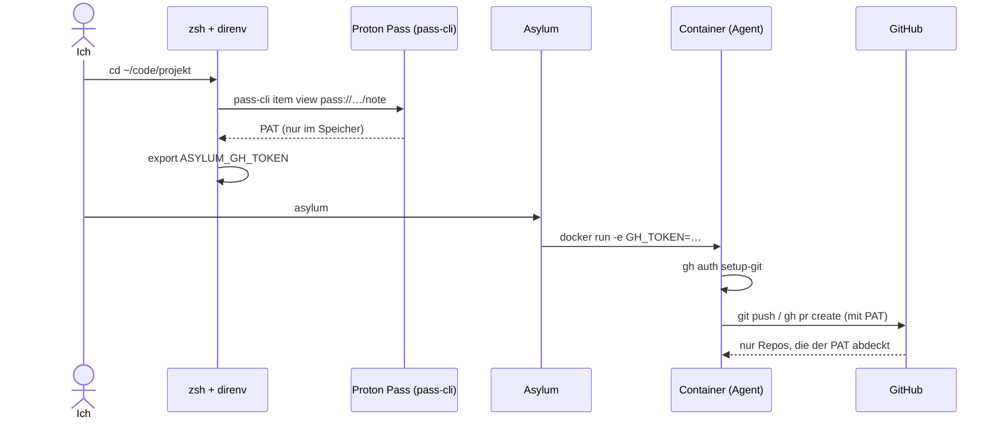
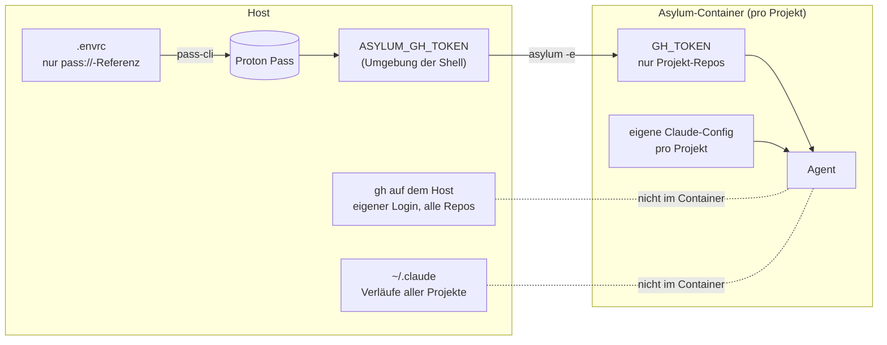

# Coding-Agents in der Sandbox – mit genau den Rechten, die sie brauchen

Coding-Agents wie Claude Code arbeiten am produktivsten, wenn man sie lässt: ohne Rückfrage bei jedem Befehl. Dafür laufen sie bei mir in [Asylum](https://github.com/inventage-ai/asylum), einem Docker-Container pro Projekt. Offen blieb eine Frage: Wie kommt der Agent an GitHub, ohne dass er meinen persönlichen Zugang mit Zugriff auf alle Repos bekommt?

## Ziel

- Der Agent sieht **nur die Repos seines Projekts**.
- Der Token liegt **in keiner Datei, die ich pflege**: nicht im Repo, nicht in einer Config, nicht im Dateisystem des Containers.
- Auf dem Host arbeite ich weiter **mit meinem eigenen Login**, unverändert.
- Für ein neues Projekt braucht es nur wenige Schritte, danach genügt ein `asylum`.

## Die Bausteine

| Baustein | Aufgabe |
|---|---|
| **GitHub Fine-grained PAT** | Ein Token pro Projekt, nur für ausgewählte Repos, mit Ablaufdatum |
| **Proton Pass** | Bewahrt den Token als Notiz auf |
| **pass-cli** | Liest den Token beim Betreten des Projekts aus Proton Pass |
| **direnv + `.envrc`** | Setzt `ASYLUM_GH_TOKEN`, solange ich im Projektverzeichnis bin |
| **zsh-Funktion `asylum`** | Reicht den Token als `GH_TOKEN` an den Container weiter |
| **gh im Container** | Authentisiert `gh` und `git` über `GH_TOKEN` |

## Ablauf

## Was wo liegt

## Drei Stolpersteine

1. **Bequeme Defaults sind zu grosszügig.** Asylums Option `credentials: auto` für GitHub kopiert den vollen Token von `gh` auf dem Host in jeden Container. Die Claude-Einstellung `config: shared` bindet `~/.claude` ein, und damit die Verläufe aller Projekte. Beides habe ich abgeschaltet.
2. **Der Name der Variable zählt.** Hiesse sie auf dem Host `GH_TOKEN`, würde sie meinen eigenen `gh`-Login im Projektverzeichnis überdecken. Darum heisst sie dort `ASYLUM_GH_TOKEN` und wird erst beim Start zu `GH_TOKEN`.
3. **Ganz ohne Datei geht es mit Docker nicht.** Docker legt Umgebungsvariablen in den Metadaten des Containers ab, lesbar mit `docker inspect`. Asylum entfernt den Container nach der letzten Sitzung, damit verschwinden auch diese Daten. Für mich ist das ein akzeptabler Kompromiss.

## Mehrere Repos, ein Token

direnv nimmt die nächstgelegene `.envrc` in einem übergeordneten Verzeichnis. Eine `.envrc` im Kundenordner gilt für alle Repos darunter. Repos mit eigener `.envrc` laden sie mit `source_up` dazu.

## Grenzen

- Asylum ist Schadensbegrenzung, keine Sicherheits-Sandbox. Netzwerkzugriff ist offen.
- Fine-grained PATs laufen ab und müssen von Hand erneuert werden ("Regenerate" in GitHub).
- Ein Token, der mehrere Repos abdeckt, gilt in jedem dieser Container.

Die Anleitung für Agents und die Einrichtung auf dem Host liegen als Skill in [loeti/agent-skills](https://github.com/loeti/agent-skills/tree/main/skills/asylum-credentials).
