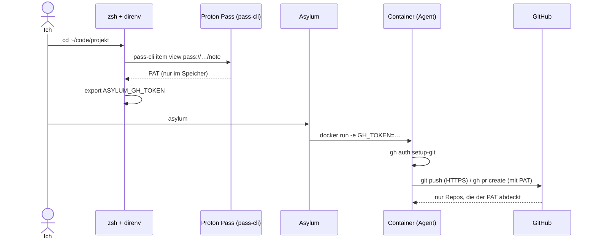
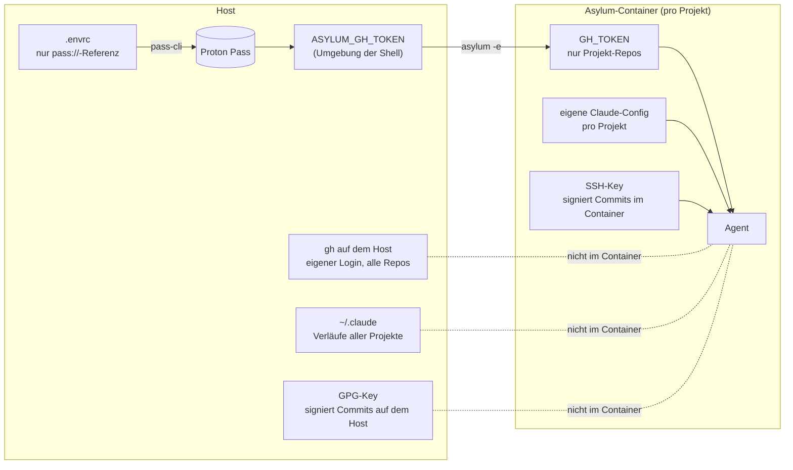

# Coding-Agents in der Sandbox – mit genau den Rechten, die sie brauchen

Coding-Agents wie Claude Code arbeiten am produktivsten, wenn man sie lässt: ohne Rückfrage bei jedem Befehl. Dafür laufen sie bei mir in [Asylum](https://github.com/inventage-ai/asylum), einem Docker-Container pro Projekt. Offen blieb eine Frage: Wie kommt der Agent an GitHub, ohne dass er meinen persönlichen Zugang mit Zugriff auf alle Repos bekommt?

> **Stand 26.10.2026.** Beschrieben ist das Setup mit Asylum v0.8.1. Mehrere meiner Pull Requests sind inzwischen auf `main` gemergt, aber noch in keinem stabilen Release. Der Abschnitt [Mit den PRs](#mit-den-prs) zeigt, wie die Konfiguration danach aussieht.

## Ziel

- Der Agent sieht **nur die Repos seines Projekts**.
- Der Token liegt **in keiner Datei, die ich pflege**: nicht im Repo, nicht in einer Config, nicht im Dateisystem des Containers.
- Auf dem Host arbeite ich weiter **mit meinem eigenen Login**, unverändert.
- Commits aus dem Container sind **signiert** und auf GitHub "Verified".
- Für ein neues Projekt braucht es nur wenige Schritte, danach genügt ein `asylum`.

## Die Bausteine

| Baustein | Aufgabe |
|---|---|
| **GitHub Fine-grained PAT** | Ein Token pro Projekt, nur für ausgewählte Repos, mit Ablaufdatum |
| **Proton Pass** | Bewahrt den Token als Notiz auf |
| **pass-cli** | Liest den Token beim Betreten des Projekts aus Proton Pass |
| **direnv + `.envrc`** | Setzt `ASYLUM_GH_TOKEN`, solange ich im Projektverzeichnis bin |
| **zsh-Funktion `asylum`** | Reicht den Token als `GH_TOKEN` an den Container weiter und legt die Claude-Config des Projekts leer an |
| **gh im Container** | Authentisiert `gh` und `git` über `GH_TOKEN` |
| **SSH-Key des Containers** | Signiert Commits, auf GitHub als Signing Key hinterlegt |

## Ablauf



## Was wo liegt



## Konfiguration heute (v0.8.1)

`~/.asylum/config.yaml`, die relevanten Teile:

```yaml
agents:
  claude:
    config: project          # eigene Claude-Config pro Projekt statt ~/.claude

kits:
  github:
    credentials: false       # nicht den vollen gh-Token des Hosts kopieren

# Commits mit dem SSH-Key des Containers signieren (siehe "Commits signieren")
env:
  GIT_CONFIG_COUNT: "2"
  GIT_CONFIG_KEY_0: gpg.format
  GIT_CONFIG_VALUE_0: ssh
  GIT_CONFIG_KEY_1: user.signingkey
  GIT_CONFIG_VALUE_1: /Users/<ich>/.ssh/id_ed25519.pub
```

`~/.zshrc`, gekürzt:

```zsh
asylum() {
  # Claude-Config des Projekts leer anlegen, sonst kopiert Asylum ganz ~/.claude hinein
  local cdir="$HOME/.asylum/projects/<container-name>/claude-config"
  mkdir -p "$cdir"
  # PAT und weitere Secrets aus direnv als -e weiterreichen
  local -a envargs
  [[ -n "$ASYLUM_GH_TOKEN" ]] && envargs+=(-e GH_TOKEN="$ASYLUM_GH_TOKEN")
  local v; for v in ${=ASYLUM_PASS_ENV}; do envargs+=(-e "$v=${(P)v}"); done
  command ${ASYLUM_BIN:-asylum} "${envargs[@]}" "$@"
}
asylum-dev() { ASYLUM_BIN=/pfad/zu/asylum/build/asylum-darwin-arm64 asylum "$@"; }
```

Die vollständige Funktion, inklusive Formel für den Container-Namen, steht in der [Host-Einrichtung des Skills](../skills/asylum-credentials/references/host-setup.md).

## Commits signieren

Asylum kopiert `~/.gitconfig` in den Container, inklusive `commit.gpgsign = true` und meinem GPG-Key. Der private Schlüssel und der gpg-agent fehlen dort aber, also scheitert jeder Commit mit `No secret key`.

Der Container hat dafür einen eigenen SSH-Key (`~/.asylum/ssh/id_ed25519`, im Container unter `~/.ssh/`), und Git kann auch mit SSH-Keys signieren. Die Variablen `GIT_CONFIG_*` im `env:`-Block oben stellen Git im Container darauf um. Sie haben Vorrang vor jeder `.gitconfig`, die kopierte Datei bleibt unverändert, und auf dem Host signiere ich weiter mit GPG.

Einmalig: `~/.asylum/ssh/id_ed25519.pub` in GitHub unter *Settings → SSH and GPG keys* als **Signing Key** eintragen. Ein Signing Key gibt keinen Zugriff auf Repos.

Den gpg-agent des Hosts weiterzureichen geht nicht: Docker Desktop auf macOS kann keine Unix-Sockets des Hosts in den Container mounten. Und der Agent könnte damit unbemerkt mit meinem persönlichen Key signieren.

## Mit den PRs

Diese Änderungen sind auf `main` von Asylum gemergt und im *Development Build* enthalten, aber noch nicht in einem stabilen Release:

| PR | Änderung | Was es bei mir ersetzt |
|---|---|---|
| [#42](https://github.com/inventage-ai/asylum/pull/42) | `env-from-host`: Host-Variable unter anderem Namen in den Container | `-e GH_TOKEN=…` und `ASYLUM_PASS_ENV` in der zsh-Funktion |
| [#44](https://github.com/inventage-ai/asylum/pull/44) | `agents.<agent>.seed: full \| settings \| none` | `mkdir` der leeren Claude-Config in der zsh-Funktion |
| [#45](https://github.com/inventage-ai/asylum/pull/45) | Umgebungsvariablen per env-File statt `-e NAME=wert` an `docker run` | Stolperstein 3 (Secrets in der Prozessliste) |
| 2a1a774 | Terminal-Modi nach Sitzungsende zurücksetzen ([#46](https://github.com/inventage-ai/asylum/issues/46)) | Workaround für iTerm im Mouse-Tracking-Modus |

Danach sieht die Konfiguration so aus:

```yaml
# ~/.asylum/config.yaml
agents:
  claude:
    config: project
    seed: settings           # Settings, Skills, Login; keine Verläufe anderer Projekte

env-from-host:
  GH_TOKEN: ASYLUM_GH_TOKEN  # Container-Name: Host-Name, nicht gesetzt = übersprungen
```

```yaml
# .asylum.local im Projekt, für projektspezifische Secrets aus direnv
env-from-host:
  HKB_MAVEN_PASSWORD: HKB_MAVEN_PASSWORD
```

Die zsh-Funktion fällt weg, `asylum` und `asylum-dev` sind wieder ein normaler Befehl bzw. Alias. Zu beachten:

- `env-from-host` und `seed` gelten nur in `~/.asylum/config.yaml` und `.asylum.local`. In der eingecheckten `.asylum` ignoriert Asylum sie mit einer Warnung.
- `seed: settings` kopiert nur, was in `~/.claude` liegt. Eine Statusline, die nicht in der dortigen `settings.json` steht, muss im Projekt nachgetragen werden. User-MCP-Server aus `~/.claude.json` und Plugins müssen im Container neu eingerichtet werden.
- Werte bleiben mit `docker inspect` lesbar, siehe Stolperstein 3.

Noch offen: [#50](https://github.com/inventage-ai/asylum/pull/50) (`host-mcp`-Kit für MCP-Server, die nur auf dem Host laufen, siehe [asylum-xcode](../skills/asylum-xcode)). Die Server stehen dann unter `kits.host-mcp.servers` und nur in `~/.asylum/config.yaml`, nicht in `.asylum` oder `.asylum.local`.

## Stolpersteine

1. **Bequeme Defaults sind zu grosszügig.** Asylums Option `credentials: auto` für GitHub kopiert den vollen Token von `gh` auf dem Host in jeden Container. Die Claude-Einstellung `config: shared` bindet `~/.claude` ein, und damit die Verläufe aller Projekte. Beides habe ich abgeschaltet.
2. **Der Name der Variable zählt.** Hiesse sie auf dem Host `GH_TOKEN`, würde sie meinen eigenen `gh`-Login im Projektverzeichnis überdecken. Darum heisst sie dort `ASYLUM_GH_TOKEN` und wird erst beim Start zu `GH_TOKEN`.
3. **Ganz ohne Datei geht es mit Docker nicht.** Docker legt Umgebungsvariablen in den Metadaten des Containers ab, lesbar mit `docker inspect`. Asylum entfernt den Container nach der letzten Sitzung, damit verschwinden auch diese Daten. In v0.8.1 stehen die Werte zusätzlich als `-e NAME=wert` in der Prozessliste (`ps`), solange die Sitzung läuft. #45 behebt das.
4. **direnv braucht seinen Hook.** Ohne `eval "$(direnv hook zsh)"` am Ende von `~/.zshrc` lädt direnv die `.envrc` beim `cd` nicht, und `asylum` startet ohne Token. `direnv allow` funktioniert trotzdem, deshalb fällt der fehlende Hook nicht auf. Prüfen lässt es sich im Projektverzeichnis mit `[ -n "$ASYLUM_GH_TOKEN" ] && echo gesetzt || echo LEER`.
5. **Ein Alias umgeht die Funktion.** `alias asylum-dev=/pfad/zum/binary` ruft Asylum direkt auf, ohne `-e GH_TOKEN`. Der Container startet ohne Token, und `gh` meldet "not logged in". Darum ist `asylum-dev` oben eine Funktion. Der Token wird nur beim Erstellen des Containers übernommen: Nach einer Korrektur alle Sitzungen beenden, damit der Container neu entsteht.
6. **Pushen über SSH scheitert.** Der SSH-Key des Containers ist für alle Projekte derselbe (`isolation: isolated`) und hat bei GitHub keinen Push-Zugriff. Als Deploy-Key taugt er nicht, weil GitHub einen Deploy-Key nur in einem einzigen Repo zulässt. Der Agent pusht deshalb über HTTPS mit dem PAT: `gh auth setup-git` plus `url."https://github.com/".insteadOf "git@github.com:"`, so bleiben die SSH-Remotes unverändert. Der PAT braucht dafür "Contents: Read and write" und für PRs "Pull requests: Read and write".
7. **`kits.shell.entrypoint` wird ignoriert.** Die Kommentare in der generierten `config.yaml` beschreiben die Option, Asylum liest sie aber nicht (nur `shell.build`). Einstellungen nur für den Container, wie das Signieren, laufen deshalb über `env:`.

## Mehrere Repos, ein Token

direnv nimmt die nächstgelegene `.envrc` in einem übergeordneten Verzeichnis. Eine `.envrc` im Kundenordner gilt für alle Repos darunter. Repos mit eigener `.envrc` laden sie mit `source_up` dazu.

## Grenzen

- Asylum ist Schadensbegrenzung, keine Sicherheits-Sandbox. Netzwerkzugriff ist offen.
- Der Agent kann `.asylum` und `.asylum.local` im Projekt schreiben und damit beim nächsten Start Volumes, Kits oder Umgebungsvariablen erweitern ([#47](https://github.com/inventage-ai/asylum/issues/47), offen). Ein `:ro`-Mount in diesen Dateien ist deshalb keine Grenze.
- Das `docker`-Kit startet den Container privilegiert, was einen Ausbruch in die VM und das Dateisystem des Hosts erlaubt ([#48](https://github.com/inventage-ai/asylum/issues/48), offen).
- Fine-grained PATs laufen ab und müssen von Hand erneuert werden ("Regenerate" in GitHub).
- Ein Token, der mehrere Repos abdeckt, gilt in jedem dieser Container.

Die Anleitung für Agents und die Einrichtung auf dem Host liegen als Skill in [loeti/agent-skills](https://github.com/loeti/agent-skills/tree/main/skills/asylum-credentials).
